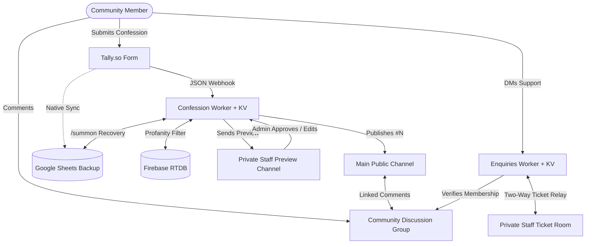

# ☕ kopi-maker

**This is not what you think.**

Despite the decoy repository description, this is **not** a coffee brewing calculator. It is a production-grade, zero-cost, serverless **Anonymous Confession & Community Moderation Suite** built on **Cloudflare Workers**, **Cloudflare KV**, **Firebase Realtime Database**, **Tally Forms**, and **Google Apps Script**.

Designed for high-volume campus or community channels (8,000+ members), this architecture decouples public confession publishing from user support inquiries across two isolated serverless workers—preserving moderator anonymity while staying well within free-tier cloud quotas.

---

## ⚡ Why `kopi-maker` Is Different

Most open-source Telegram confession bots on GitHub are single-file Python/Node scripts hosted on free containers that sleep, cold-start, or run out of credits—or pure Google Apps Script setups that choke on large media uploads and hit execution timeouts.

`kopi-maker` is engineered around **edge-serverless quota optimization and real moderation UX**:

| Capability | Typical Hobby Confession Bot | `kopi-maker` Serverless Suite |
| :--- | :--- | :--- |
| **Hosting & Uptime** | Paid VPS or free containers that sleep and cold-start | **Cloudflare Workers + KV (\$0/mo, always-on global edge)** |
| **KV Quota Engineering** | Naive writes burn through free-tier limits rapidly | **4–5 KV writes per post (~200–250+ daily posts on free tier)** |
| **Media & Albums** | Text-only or single photo; fails on multi-file uploads | **2–10 item albums, videos, file links & text-only `/summon` fallback** |
| **Pre-Post Editing** | None—admins must reject or manually repost typos | **Native Telegram text & album photo editing synced before publish** |
| **Long Text & Floods** | Crashes on Telegram's 1,024-char caption limit or hits `429` bans | **Auto-splitting (`...`) + dynamic cooldown spacing** |
| **Support & OpSec** | Exposes admin accounts or custom domains in SSL logs | **`*.workers.dev` isolation + group-gated support relay** |
| **Dropped Webhooks** | Entry is lost permanently if a webhook hiccups | **`/summon <id>` instant recovery from Google Sheets backup** |

---

## 🏗️ System Architecture



---

## ✨ Core Capabilities

### 1. Confession Publisher Bot (`confession-bot/`)
* **Zero-Cost High Throughput:** Engineered around Cloudflare KV write-minimization patterns (4–5 KV writes per standard post), sustaining **200–250+ posts/day** on Cloudflare's free tier without requiring a custom domain.
* **Operational Anonymity (`*.workers.dev`):** Runs entirely on Cloudflare's shared `*.workers.dev` subdomain so administrators never expose personal domains in public Certificate Transparency (SSL) logs.
* **Rich Media & Album Handling:** Supports plain text, single photos/videos, **2–10 item media albums**, and automatic fallback attachment links for non-media files.
* **Smart Text & Caption Splitting:** Automatically splits captions exceeding Telegram's 1,024-character limit into separate media + text replies, and chunks texts exceeding 3,800 characters with `...` continuation markers.
* **Live Native Edit Sync:** Moderators can directly edit text chunks, captions, or swap photos/videos inside the private Telegram preview channel before publishing—changes sync automatically when **Submit / Post** is clicked.
* **UTF-8 Surrogate Sanitization:** Strips broken half-emojis (unpaired UTF-16 surrogates) that would otherwise trigger Telegram `400 Bad Request` API rejections.
* **Dynamic Anti-`429` Rate Limiting:** Calculates adaptive cooldown windows based on album size and chunk count to prevent Telegram flood-wait errors during rapid posting.
* **Dynamic Profanity Filter:** Fetches and caches banned words/phrases from Firebase Realtime Database, manageable live via `/swear add` and `/swear remove`.
* **Disaster Recovery (`/summon`):** Pulls dropped or historical submissions directly from a linked Google Sheet backup via Google Apps Script (`SummonApi.gs`).

### 2. Enquiries & Support Relay Bot (`enquiries-bot/`)
* **Anti-Spam Membership Gate:** Verifies via Telegram's `getChatMember` API (cached in KV) that a user is an active member of your community discussion group before forwarding messages.
* **Privacy-Respecting Two-Way Relay:** Forwards user text and media into a private staff room while honoring Telegram's native Forward Privacy settings, allowing admins to reply anonymously by simply replying to the ticket message.
* **Built-In Moderation Controls:** Includes per-user anti-spam cooldowns and instant `/ban` / `/unban` blocklist enforcement.

---

## 📂 Repository Structure

```text
kopi-maker/
├── README.md                     # Architecture overview & documentation index
├── LICENSE                       # MIT License
├── .gitignore                    # Secret & environment exclusions
├── swearwords.example.json       # Sample profanity array for Firebase RTDB import
├── confession-bot/
│   ├── GUIDE.md                  # Complete setup manual for the Confession Publisher Bot
│   ├── worker.js                 # Cloudflare Worker backend (Confession Publisher)
│   └── SummonApi.gs              # Google Apps Script backup lookup API
└── enquiries-bot/
    ├── GUIDE.md                  # Complete setup manual for the Support Relay Bot
    └── worker.js                 # Cloudflare Worker backend (Support & Ticket Relay)
```

---

## 📚 Setup Documentation

Both components are completely independent and must be deployed as **two separate Cloudflare Workers** with **two separate Telegram bot tokens**:

1. **[Confession Publisher Bot — Complete Setup Guide](./confession-bot/GUIDE.md)**
   * Covers Telegram bot creation, Firebase Realtime Database & security rules, Cloudflare Worker + KV deployment, Tally webhook integration, and Google Apps Script `/summon` setup.
2. **[Enquiries & Support Bot — Complete Setup Guide](./enquiries-bot/GUIDE.md)**
   * Covers Telegram support bot creation, discussion group membership gating, Cloudflare Worker + KV deployment, and anonymous two-way ticket routing.

---

## ⚠️ Disclaimer & Support Policy

* **Provided "As-Is":** This codebase is released under the MIT License strictly for educational and community self-hosting purposes.
* **No Free Tech Support:** Please read the step-by-step guides thoroughly. Every configuration flag, permission requirement, and edge case is documented inside `confession-bot/GUIDE.md` and `enquiries-bot/GUIDE.md`.

---

*☕ Brewed late at night with zero budget and too much caffeine.*